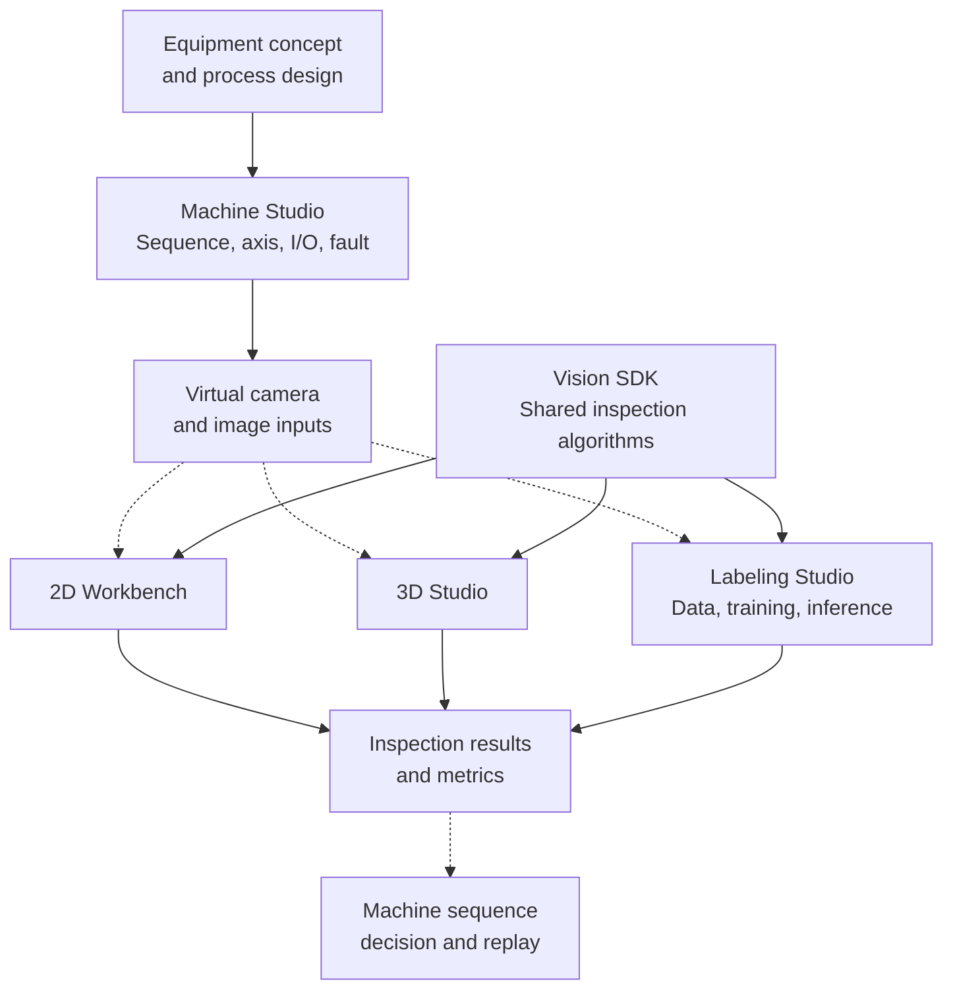

<div align="center">

# Noah Choi

### Industrial Machine Vision Software Engineer

**Building open-source tools for machine-vision development before the physical machine is ready.**

[](mailto:dhqtlzm12@naver.com)
[](https://marketplace.visualstudio.com/items?itemName=openvisionlab.RawBufferVisualizer)

</div>

## Start here

| I want to… | Project | Status |
| --- | --- | --- |
| Inspect images and raw buffers while debugging C# | [Raw Buffer Visualizer](https://github.com/Noah8218/RawBufferVisualizer) | VS Marketplace |
| Build a rule-based 2D inspection | [2D Workbench](https://github.com/Noah8218/OpenVisionLab) | Usable |
| Label data, train and compare models | [Labeling Studio](https://github.com/Noah8218/OpenVisionLab-Labeling-Studio) | Usable |
| Teach and run 3D Thickness / Warpage | [3D Studio](https://github.com/Noah8218/OpenVisionLab-3D-Studio) | Usable |
| Simulate a machine before hardware | [Machine Studio](https://github.com/Noah8218/OpenVisionLab-Machine-Studio) | Active development |
| Reuse inspection algorithms in code | [Vision SDK](https://github.com/Noah8218/OpenVisionLab-Vision-SDK) | Source available |

## Projects

<table>
  <tr>
    <td width="360" valign="top">
      <a href="https://github.com/Noah8218/OpenVisionLab"></a>
    </td>
    <td valign="top">
      <h3><a href="https://github.com/Noah8218/OpenVisionLab">2D Workbench</a></h3>
      <p>Build and validate rule-based 2D inspection Recipes on Windows with OpenCvSharp and C#.</p>
      <ul>
        <li>Teach Tools, ROIs and acceptance limits in an ordered Pipeline.</li>
        <li>Save Recipes and compare Good/Bad samples with batch inspection.</li>
      </ul>
      <a href="https://github.com/Noah8218/OpenVisionLab">Repository</a>
    </td>
  </tr>
  <tr>
    <td width="360" valign="top">
      <a href="https://github.com/Noah8218/OpenVisionLab-Labeling-Studio"></a>
    </td>
    <td valign="top">
      <h3><a href="https://github.com/Noah8218/OpenVisionLab-Labeling-Studio">Labeling Studio</a></h3>
      <p>Label industrial images, train and compare models, and run inference on one PC.</p>
      <ul>
        <li>Create boxes, polygons, masks and image-level OK/NG decisions.</li>
        <li>Review Smart Mask candidates before applying and saving labels.</li>
      </ul>
      <a href="https://github.com/Noah8218/OpenVisionLab-Labeling-Studio">Repository</a>
    </td>
  </tr>
  <tr>
    <td width="360" valign="top">
      <a href="https://github.com/Noah8218/OpenVisionLab-3D-Studio"></a>
    </td>
    <td valign="top">
      <h3><a href="https://github.com/Noah8218/OpenVisionLab-3D-Studio">3D Studio</a></h3>
      <p>Teach a 3D inspection, save the recipe and inspect a batch of files.</p>
      <ul>
        <li>Set ROIs and limits for Thickness and Warpage.</li>
        <li>Review per-file measurements and saved Run Records.</li>
      </ul>
      <a href="https://github.com/Noah8218/OpenVisionLab-3D-Studio">Repository</a>
    </td>
  </tr>
  <tr>
    <td width="360" valign="top">
      <a href="https://github.com/Noah8218/OpenVisionLab-Machine-Studio"></a>
    </td>
    <td valign="top">
      <h3><a href="https://github.com/Noah8218/OpenVisionLab-Machine-Studio">Machine Studio</a></h3>
      <p>Configure a virtual machine, write its control sequence and check behavior before hardware commissioning.</p>
      <ul>
        <li>Arrange devices, signals, sequences and virtual cameras.</li>
        <li>Run simulations and review faults, scenario checks and records.</li>
      </ul>
      <a href="https://github.com/Noah8218/OpenVisionLab-Machine-Studio">Repository</a>
    </td>
  </tr>
  <tr>
    <td width="360" valign="top">
      <a href="https://github.com/Noah8218/OpenVisionLab-Vision-SDK"></a>
    </td>
    <td valign="top">
      <h3><a href="https://github.com/Noah8218/OpenVisionLab-Vision-SDK">Vision SDK</a></h3>
      <p>Reuse C# inspection algorithms in your own applications.</p>
      <ul>
        <li>Use UI-independent 2D and height-map/full-XYZ 3D computation.</li>
        <li>Read shared result states, metrics and overlays.</li>
      </ul>
      <a href="https://github.com/Noah8218/OpenVisionLab-Vision-SDK">Repository</a>
    </td>
  </tr>
  <tr>
    <td width="360" valign="top">
      <a href="https://github.com/Noah8218/RawBufferVisualizer"></a>
    </td>
    <td valign="top">
      <h3><a href="https://github.com/Noah8218/RawBufferVisualizer">Raw Buffer Visualizer</a></h3>
      <p>Inspect image variables and raw buffers at a Visual Studio breakpoint.</p>
      <ul>
        <li>Open supported Bitmap, Mat, pointer and raw-buffer data.</li>
        <li>Inspect pixels and buffer layouts, and compare retained images.</li>
      </ul>
      <a href="https://github.com/Noah8218/RawBufferVisualizer">Repository</a>
    </td>
  </tr>
</table>

## What's new

<!-- Keep at most three dated, user-facing milestones. Verify dates and versions in the linked project history; keep detailed changes there. -->

| Date | Milestone |
| --- | --- |
| 2026-10-26 | **Labeling Studio 0.3.7:** Refreshed labeling workflows and Smart Mask examples. [Release notes](https://github.com/Noah8218/OpenVisionLab-Labeling-Studio/blob/main/RELEASE_NOTES.md) |
| 2026-10-17 | **2D Workbench 2.2.0-dev.8:** Smoother Recipe transitions, tool editing and inspection-result review. [Changelog](https://github.com/Noah8218/OpenVisionLab/blob/main/CHANGELOG.md) |
| 2026-10-16 | **3D Studio 0.7.0-dev:** Reworked recipe teaching and result recovery; added C3D appearance overlays. [Changelog](https://github.com/Noah8218/OpenVisionLab-3D-Studio/blob/main/CHANGELOG.md) |

## Roadmap

- **Next:** Connect Machine Studio acquisition to 2D, 3D and Labeling inspection workflows.
- **Planned:** Generative AI-based validation image data.

## About

I am an industrial machine-vision software engineer with **8 years of experience across 20+ equipment projects** in semiconductor, display, battery, and automotive manufacturing.

OpenVisionLab is my personal open-source R&D ecosystem for C# machine-vision developers.

I am building it to connect virtual equipment, image data, inspection software, reusable algorithms and validation workflows.

> **When software development starts only after the machine and samples are ready, validation risk is concentrated near the end of the schedule.**


<details>
<summary>OpenVisionLab Direction</summary>

Solid arrows show available workflows or SDK reuse. Dashed arrows mark direct cross-project integration still in development.



The purpose is not to replace real equipment validation. It is to **move architecture, sequence, inspection, failure-mode and integration verification earlier**, so physical-machine time can be used for the things that truly require hardware, optics and production samples.

</details>

<details>
<summary>Experience Behind the Projects</summary>

These personal projects are based on problems I have handled in production machine-vision systems rather than isolated demo applications.

### Machine Vision

- 2D: Edge, Blob, Contour, Pattern Matching, Line Gauge and measurement
- 3D: Height Map, Full XYZ, Thickness and Warpage
- Image coordinate conversion, defect merging and inspection-result processing
- Area Scan and Line Scan camera workflows

### Equipment Software

- Camera, lighting, I/O, sensor, PLC and motion integration
- Inspection Sequence and Recipe architecture
- TOP / BTM independent processing and multi-worker execution
- Timeout, recovery and delayed-callback isolation
- Long-running equipment-state and error-handling design

### Performance & Interop

- C++ DLL / C++/CLI / C# interoperability
- Large unmanaged image buffers
- Multi-threaded inspection queues
- Rule / AI inspection-module integration
- Native / managed boundary design

### Desktop & Tooling

- C# / .NET
- WPF / WinForms
- OpenCvSharp
- Visual Studio extensions
- Git / SVN / Jenkins / GitHub Actions

</details>

<details>
<summary>Engineering Principles</summary>

```text
Build earlier.
Validate explicitly.
Keep state deterministic.
Fail safely.
Preserve evidence.
Make problems reproducible.
```

I prefer engineering that improves **stability, traceability, recovery and reproducibility** over adding complexity only for novelty.

For machine-vision software, an algorithm producing the right result once is not enough. The complete system must acquire the correct image, execute the correct inspection at the correct time, preserve the result, recover from failure, and provide enough evidence to explain what happened later.

</details>

If a project saves you time, a star or follow helps other vision developers find it.
